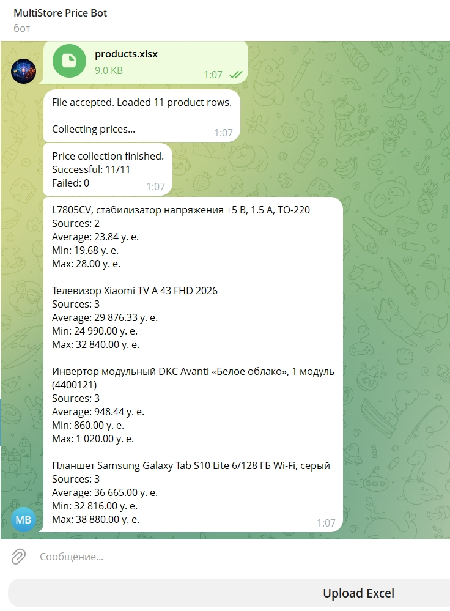

<div align="center">

# Telegram Price Scraper Bot

A Telegram bot for collecting and comparing product prices across multiple online stores using Excel spreadsheets.


[](https://github.com/nikolaitolmachev/telegram-price-scraper-bot/actions/workflows/ci.yml)
[](LICENSE)

</div>

## Features

- **Excel-based input** — upload spreadsheets containing product names, URLs, and optional CSS/XPath selectors.
- **Concurrent price scraping** — collect prices from multiple online stores using Playwright.
- **Multiple extraction methods** — extract prices from JSON-LD, Microdata, or custom selectors.
- **Price comparison** — calculate average, minimum, and maximum prices for each product.
- **SQLite persistence** — store scraping runs and individual results, including failed attempts.
- **Telegram interface** — upload files and receive price summaries directly in the chat.

---

## Screenshot

<p align="center">
  
</p>

---

## Tech Stack

- **Python 3.12+** — core application language.
- **aiogram 3** — asynchronous Telegram bot framework.
- **Playwright** — browser automation and product price scraping.
- **Beautiful Soup 4** — HTML parsing and structured data extraction.
- **pandas / openpyxl** — Excel file processing.
- **SQLite** — persistence of scraping runs and price results.
- **pytest / pytest-asyncio** — automated testing.
- **Ruff** — linting and code formatting.
- **GitHub Actions** — continuous integration.

---

## Architecture

The application follows a modular architecture that separates Telegram interactions, data processing, web scraping, and database operations.

```text
                  Telegram User
                        |
                        v
                 Telegram Bot
                 (app/bot/)
                        |
                        v
                Excel Validation
               (app/services/)
                        |
                        v
               Concurrent Scraping
                (app/scraping/)
                        |
              +---------+---------+
              |         |         |
              v         v         v
           JSON-LD   Microdata   CSS/XPath
              |         |         |
              +---------+---------+
                        |
                        v
                  Price Results
                        |
              +---------+---------+
              |                   |
              v                   v
        Price Aggregation    SQLite Storage
         (app/services/)     (app/database/)
              |
              v
        Telegram Summary
```

**Core components:**

- **`app/bot/`** — handles Telegram commands, Excel uploads, and conversation states.
- **`app/scraping/`** — manages Playwright browser sessions, concurrent scraping, and price extraction.
- **`app/services/`** — validates Excel files and calculates price statistics.
- **`app/database/`** — stores scraping runs and individual results in SQLite.

Scraping uses isolated browser contexts with bounded concurrency. Prices are extracted in priority order: JSON-LD, Microdata, then an optional CSS/XPath selector.

---

## Getting Started

### Prerequisites

- Python 3.12 or newer
- Git
- A Telegram bot token obtained from [@BotFather](https://t.me/BotFather)

### Installation

1. Clone the repository:

   ```bash
   git clone https://github.com/nikolaitolmachev/telegram-price-scraper-bot.git
   cd telegram-price-scraper-bot
   ```

2. Create and activate a virtual environment:

   ```bash
   python3 -m venv .venv
   source .venv/bin/activate
   ```

3. Install the project and Playwright Chromium:

   ```bash
   python -m pip install -e .
   python -m playwright install chromium
   ```

4. Configure the environment:

   ```bash
   cp .env.example .env
   ```

   Set your Telegram bot token in `.env`:

   ```dotenv
   BOT_TOKEN=your_telegram_bot_token
   ```

5. Start the bot:

   ```bash
   python -m app.main
   ```

### Usage

1. Open your Telegram bot and send `/start`.
2. Select **Upload Excel**.
3. Upload an `.xlsx` file containing product names, URLs, and optional selectors.
4. Receive price collection statistics and comparison summaries directly in Telegram.

### Development Checks

Install the development dependencies:

```bash
python -m pip install -e ".[dev]"
```

Run the automated checks:

```bash
ruff check app/ tests/
ruff format --check app/ tests/
python -m pytest -q
```

The same checks run automatically through GitHub Actions.

---

## Excel Format

The bot accepts `.xlsx` files with the following columns:

| Column | Required | Description |
|---|---|---|
| `title` | Yes | Product name used to group prices from different stores. |
| `url` | Yes | Direct URL to the product page. |
| `selector` | No | Optional CSS or XPath selector used when structured price data is unavailable. |

**Example:**

| title | url | selector |
|---|---|---|
| Samsung Galaxy Tab | `https://store-a.example/product/123` | `.product-price` |
| Samsung Galaxy Tab | `https://store-b.example/product/456` | |
| Xiaomi TV | `https://store-c.example/product/789` | `//span[@class='price']` |

**Requirements:**

- The workbook must contain all three column headers, including `selector`, even if its values are empty.
- Rows without a product title or URL are skipped.
- Rows with the same `title` are grouped for price comparison.
- A maximum of 400 valid product rows is supported.
- The uploaded file must not exceed 5 MB.
- Prices are compared numerically without currency conversion. Use product URLs with prices in the same currency.

A ready-to-use example is available in [`examples/products.xlsx`](examples/products.xlsx).

---

## Future Improvements

- **Price history in Telegram** — add a `/history` command to view previous scraping results stored in SQLite.
- **Currency-aware comparisons** — group prices by currency or convert them using exchange rates.
- **Retry handling** — introduce exponential backoff for temporary network and scraping failures.
- **Progress tracking** — provide updates during large scraping runs.

---

## License

This project is licensed under the MIT License. See the [LICENSE](LICENSE) file for details.
